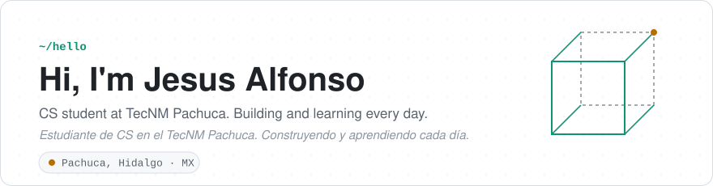
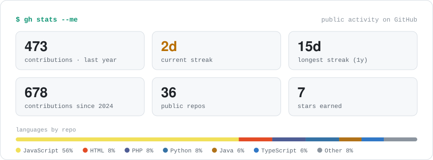
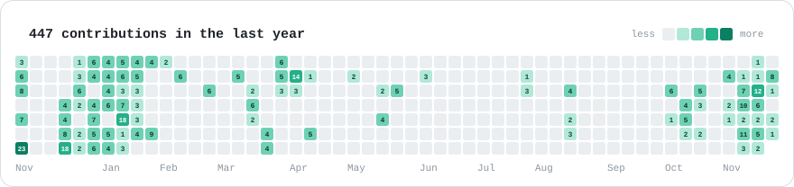
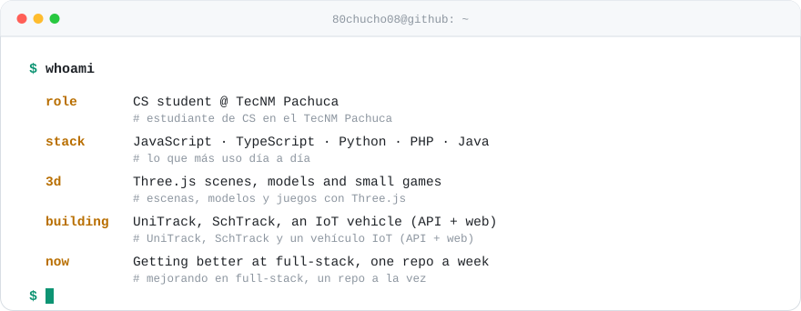

<picture><source media="(prefers-color-scheme: dark)" srcset="assets/hero-dark.svg"></picture>

<a href="https://github.com/80chucho08"><picture><source media="(prefers-color-scheme: dark)" srcset="assets/badge-github-dark.svg"></picture></a>
<a href="https://dev-personal-portafolio.vercel.app"><picture><source media="(prefers-color-scheme: dark)" srcset="assets/badge-site-dark.svg"></picture></a>
<a href="https://www.linkedin.com/in/jesusalfonsonc"><picture><source media="(prefers-color-scheme: dark)" srcset="assets/badge-linkedin-dark.svg"></picture></a>
<a href="mailto:jesuscarbajalsistemas@gmail.com"><picture><source media="(prefers-color-scheme: dark)" srcset="assets/badge-mail-dark.svg"></picture></a>

<picture><source media="(prefers-color-scheme: dark)" srcset="assets/stats-dark.svg"></picture>

<picture><source media="(prefers-color-scheme: dark)" srcset="assets/graph-dark.svg"></picture>

<picture><source media="(prefers-color-scheme: dark)" srcset="assets/whoami-dark.svg"></picture>

Cards redrawn every night by a GitHub Action · Tarjetas redibujadas cada noche por un GitHub Action

